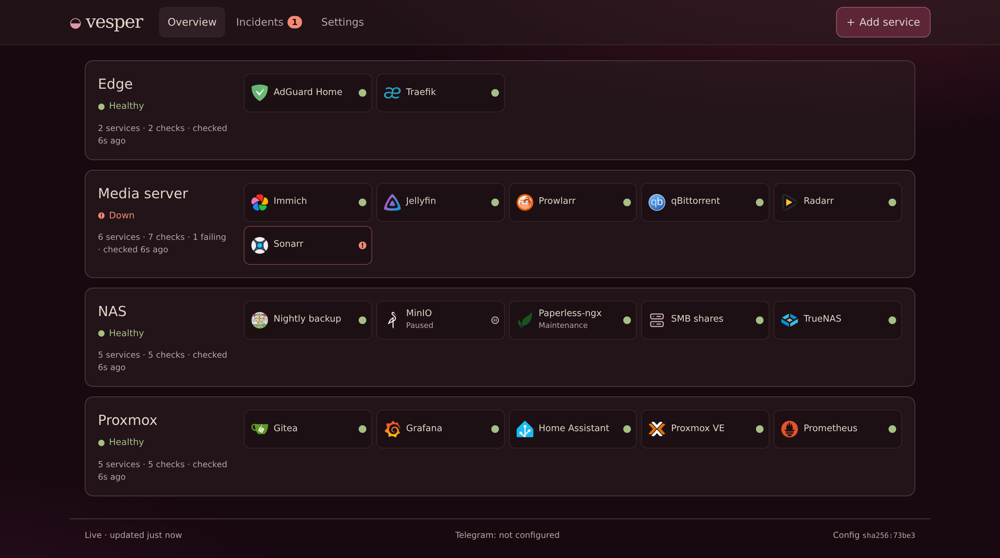
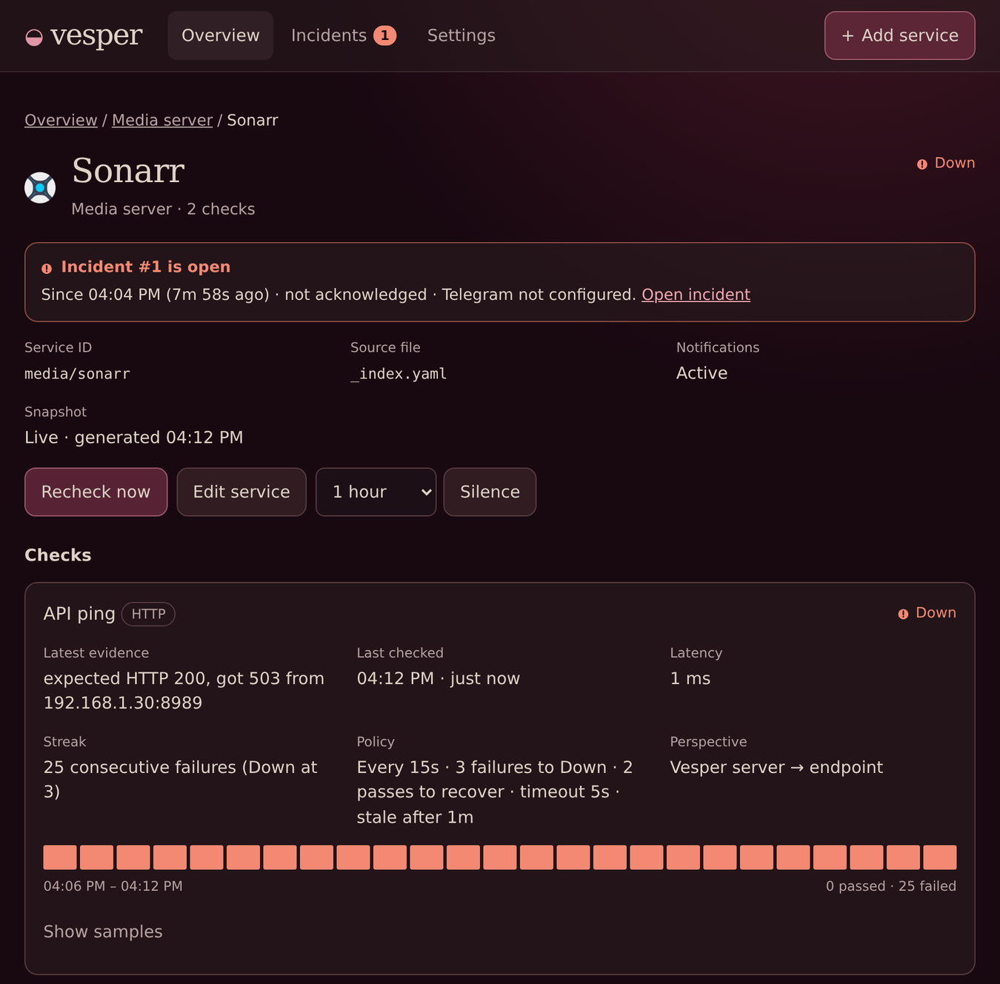
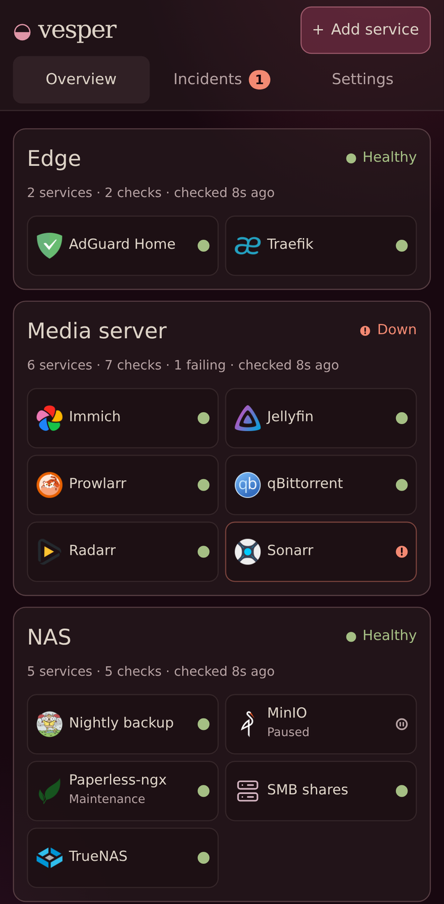

# Vesper

A status monitor for your homelab. You describe machines and services in YAML; Vesper probes them, records history in SQLite and can send incidents to the notification services Uptime Kuma supports, from Telegram, Discord and ntfy to email, SMS gateways and PagerDuty. It ships as one container with a web UI.



Each machine is a full-width row of service tiles. Open a service to see each check's latest evidence, its policy and recent samples. From there you can recheck, silence or edit it.

<table>
  <tr>
    <td width="67%"></td>
    <td width="33%"></td>
  </tr>
</table>

Screenshots show the Vesper server probing sample services on a test network.

> [!WARNING]
> **Vesper has no login of its own.** Anyone who can reach it is an administrator: they can edit monitoring YAML, silence alerts and send test notifications. Keep it on a trusted network, or put your reverse proxy's authentication in front of it. See [Security boundaries](#security-boundaries).

## Configure it in YAML

YAML is the only source of configuration. The block below is a complete `_index.yaml`: two machines, four services, five checks.

```yaml
network:
  allowed_cidrs: [192.168.1.0/24]   # the only destinations Vesper may probe

machines:
  media:
    name: Media server
    services:
      jellyfin:
        name: Jellyfin
        icon: jellyfin
        depends_on: [nas/smb]        # alerts group under SMB while it is down
        checks:
          health:
            kind: http
            url: http://192.168.1.30:8096/health
            body_contains: Healthy
      sonarr:
        name: Sonarr
        icon: sonarr
        checks:
          api: {kind: http, url: "http://192.168.1.30:8989/ping"}
          port: {kind: tcp, host: 192.168.1.30, port: 8989}

  nas:
    name: NAS
    services:
      smb:
        name: SMB shares
        checks:
          port: {kind: tcp, host: 192.168.1.40, port: 445}
      backups:
        name: Nightly backup
        icon: restic
        checks:
          restic:
            kind: push                     # the backup job reports in
            token: {file: push-nas-backups}
            expected_interval_seconds: 86400
            grace_seconds: 7200
```

```console
$ docker run --rm -v "$PWD/config:/config:ro" ghcr.io/cfbender/vesper:latest validate
Valid configuration: 2 machines, 4 services, 5 checks. Revision sha256:…
```

- **HTTP** checks expect status 200 by default; `body_contains` also requires a substring in the body. **TCP** checks need a successful connect.
- Active checks run every 30 s with a 5 s timeout. A check is Down after 3 consecutive failures and recovers after 2 passes. Override these values under `defaults:` or on any check.
- `allowed_cidrs` is deny-by-default. Loopback, link-local and cloud metadata addresses stay blocked even if listed.
- Secrets are references, never literals: `{file: name}` reads `/run/secrets/name`, and `{env: NAME}` reads the container environment.
- The UI's editor saves back to these same files. It rewrites only what you changed, and refuses a save that would drop a comment. With `VESPER_CONFIG_READ_ONLY=true`, for Git-managed config, or when Vesper's user can't write to the config directory, the UI is view-only and Settings says why.
- One file is enough to start. You can later split machines, services and checks into directories, as in [examples/config](examples/config).

Push checks invert the direction: a job on another host reports to Vesper, and a missed `expected_interval_seconds + grace_seconds` opens an incident. The token goes in a header and is read from stdin, so it never appears in a URL or argument list:

```bash
curl -fsS https://status.example.com/api/heartbeat/nas/backups/restic \
  -H @- -H 'Content-Type: application/json' -d '{"healthy": true}' \
  <<<"Authorization: Bearer $(cat /run/secrets/push-nas-backups)"
# {"accepted":true}
```

For scheduled jobs, use the ready-made producers in [examples/producers](examples/producers) with the systemd units in [examples/systemd](examples/systemd). They cover a single heartbeat, Docker container health, Proxmox node health and wrapping a job's exit code. Vesper runs no commands on other hosts, and by default it has no Docker access.

Notifications are optional. Each channel names a `kind` and that kind's settings; every channel receives every incident:

```yaml
notifications:
  dashboard_url: https://status.example.com
  channels:
    telegram:
      kind: telegram
      bot_token: {file: telegram-bot-token}
      chat_id: {file: telegram-chat-id}
    phone:
      kind: ntfy
      topic: {file: ntfy-topic}
```

[docs/notifications.md](docs/notifications.md) lists the channel kinds ported from Uptime Kuma's notification providers, from chat apps and push services to email, SMS gateways and on-call tools, with each kind's settings.

### Optional: services from Docker labels

You can also have Vesper write services from container labels:

```yaml
# On the Jellyfin container, running on the Docker host that is machine `media`:
labels:
  vesper.jellyfin.name: Jellyfin
  vesper.jellyfin.icon: jellyfin
  vesper.jellyfin.checks.health.url: http://192.168.1.30:8096/health
  vesper.jellyfin.checks.health.body_contains: Healthy
```

With `VESPER_DISCOVER_DOCKER=media=unix:///var/run/docker.sock`, `vesper serve` scans the containers every 30 s and writes `machines/media/services/jellyfin.yaml`. The machine must already exist in its own directory, as `machines/media/_index.yaml`, not inline as in the single-file example above. Discovery leaves hand-written and edited files alone.

- It is off unless `VESPER_DISCOVER_DOCKER` is set.
- It needs writable config. Vesper refuses to start with both `VESPER_DISCOVER_DOCKER` and `VESPER_CONFIG_READ_ONLY=true`.
- Secret-bearing checks need explicit per-machine grants in `VESPER_DISCOVER_ALLOWED_SECRETS`. By default labels cannot use any secret. A grant trusts that machine's label writers with the credential, so use dedicated credentials, not Vesper's Telegram bot token. See [secret grants and revocation](docs/discovery.md#granting-secrets-to-a-machine).
- **Local discovery is root-equivalent.** It mounts the Docker socket into the Vesper container and adds the socket's group. The process that serves the dashboard then controls that host's Docker, even though it still runs as UID 10001 with a read-only root and no capabilities. A socket proxy that allows only the container list is the alternative, for other hosts or to keep the socket out of the Vesper container.

[docs/discovery.md](docs/discovery.md) covers labels, setup, removed containers and security.

## Install from GHCR

Use the published image, `ghcr.io/cfbender/vesper`. It is public and built for linux/amd64. No checkout, Rust or Node toolchain is needed.

| Tag | Meaning |
| --- | --- |
| `latest` | Most recent successful `main` build |
| `sha-<full 40-character commit SHA>` | The build of that exact commit |

There are no release-version tags yet. To make a deployment repeatable, pin a digest:

```sh
docker pull ghcr.io/cfbender/vesper:latest
docker image inspect --format '{{index .RepoDigests 0}}' ghcr.io/cfbender/vesper:latest
```

Merge this service into your Compose stack. Change the URL, proxy address, host paths and network to match your stack:

```yaml
services:
  vesper:
    image: ghcr.io/cfbender/vesper:latest   # or ghcr.io/cfbender/vesper@sha256:…
    restart: unless-stopped
    user: "10001:10001"                     # or another non-root UID:GID, e.g. 1000:1000
    read_only: true
    cap_drop: [ALL]
    security_opt: [no-new-privileges:true]
    tmpfs:
      - /tmp:size=16m,mode=1777,noexec,nosuid,nodev
    environment:
      VESPER_PUBLIC_URL: https://status.example.com
      VESPER_TRUSTED_PROXIES: 172.30.0.2/32   # your reverse proxy's address
    volumes:
      - ./vesper/config:/config               # the YAML above, writable by that user
      - ./vesper/data:/data                   # SQLite history, writable by that user
      - ./vesper/secrets:/run/secrets:ro
    networks: [proxy]

networks:
  proxy:
    external: true
```

Then validate before you start it:

```sh
docker compose pull vesper
docker compose run --rm --no-deps vesper validate
docker compose up -d --no-deps vesper
```

Point your reverse proxy at `http://vesper:8080` over HTTPS, and don't publish the port on the host. The image has a built-in health check. A healthy container means only that the server is up, so open the UI and confirm checks have recent results.

The image runs `vesper serve` by default. Other commands are `vesper validate`, `vesper export` and `vesper healthcheck`. `vesper export` prints the assembled configuration as one YAML document; secrets stay as references. `vesper healthcheck` probes local liveness.

| Variable | Default | Meaning |
| --- | --- | --- |
| `VESPER_PUBLIC_URL` | (required) | Exact `https://` origin that users reach, with no path. Used for Origin/CSRF checks and links |
| `VESPER_TRUSTED_PROXIES` | (none) | Comma-separated CIDRs of the reverse proxy's immediate address. Other peers get 403 |
| `VESPER_CONFIG_DIR` | `/config` | YAML root |
| `VESPER_CONFIG_READ_ONLY` | `false` | `true` makes the UI view-only: no adding or editing services |
| `VESPER_DATA_DIR` | `/data` | SQLite (`vesper.db`) and uploaded icons |
| `VESPER_SECRETS_DIR` | `/run/secrets` | Files for `{file: name}` references and the private CA |
| `VESPER_STATIC_DIR` | `/app/web` | Built web UI |
| `VESPER_LISTEN` | `0.0.0.0:8080` | Listen address |
| `VESPER_DISCOVER_DOCKER` | (off) | Optional label discovery: `machine=endpoint` pairs, such as `media=unix:///var/run/docker.sock`. See [discovery](docs/discovery.md) |
| `VESPER_DISCOVER_ALLOWED_SECRETS` | `{}` | Exact secret references label writers may use, granted per machine. See [secret grants](docs/discovery.md#granting-secrets-to-a-machine) |
| `VESPER_DEV_MODE` | `false` | Local development only. Never set it in a deployment |

The [installation guide](docs/installation.md) covers storage permissions, read-only config, proxy setup, Telegram, push routes, backups, updates and troubleshooting. [deploy/compose.yaml](deploy/compose.yaml) is a full Traefik example. It has routing labels, an optional auth middleware, a rate-limited heartbeat route and a separate egress network. Commented-out lines there enable label discovery.

### Setting it up with an agent

The installation guide is written so a coding agent can adapt it to the stack you already run. A prompt that works:

```text
Add Vesper to my existing Docker Compose stack, following
https://github.com/cfbender/vesper/blob/main/docs/installation.md and the image
ghcr.io/cfbender/vesper. Inspect my stack first and follow its conventions for paths,
networks and the reverse proxy. Ask me before changing shared proxy, DNS or firewall
settings. Never ask me to paste secrets into chat: have me write them to files.
Run `vesper validate` before starting it, then do the checks in "Start and check".
```

## Security boundaries

Vesper is single-tenant. The deployment boundary is the security model; [docs/security.md](docs/security.md) is the full contract.

- **Authentication is optional and external.** Vesper has no users, passwords or sessions. Without proxy authentication, network reachability is the only boundary, and every reachable client is an administrator. Vesper warns about this at startup and in Settings. Reuse the auth your proxy already has. The security doc has worked examples for [Traefik BasicAuth and Authelia](docs/security.md#optional-authentication-examples) (SSO/MFA), but neither is required.
- **Turning auth off leaves the other checks on.** These are the HTTPS `VESPER_PUBLIC_URL` origin, Origin and CSRF checks on every change, and the `VESPER_TRUSTED_PROXIES` peer check. Vesper ignores forwarding and identity headers when deciding who is allowed. CSRF protection is not authentication.
- **One route skips proxy auth:** `POST /api/heartbeat/<machine>/<service>/<check>`. It still requires that check's own bearer token, returns no inventory, and gives the same 401 for every failure.
- **Outbound probes go only to `network.allowed_cidrs`.** TLS verification is always on; add a private CA with `network.private_ca_file`.
- **Secret values stay out of API responses, exports, logs and notification text.** YAML holds references; Vesper resolves them for authentication, including outbound HTTP headers and notification requests. A check author who can use a credential can send it to an allowed HTTP target. Prefer files over environment values, which `docker inspect` shows.
- **The container runs non-root**, on a read-only root filesystem, with no published port.
- **No Docker access by default.** Optional [label discovery](docs/discovery.md) with a mounted local socket gives the dashboard process root-equivalent control of that host's Docker, so a compromise of Vesper becomes a compromise of the host. Its UID, read-only root and dropped capabilities don't limit that. A restricted socket proxy that allows only the container list avoids the mount.

## Operational caveats

- **Vesper can't report its own outage.** Run an independent monitor, for example Uptime Kuma, and the [watchdog](examples/watchdog), which proves heartbeats still reach Vesper.
- **Checks are HTTP(S), TCP and push only.** There are no ICMP, DNS or certificate-expiry checks. Docker and Proxmox health arrive as pushed heartbeats.
- **There is one process and no high availability.** Automated tests build every channel kind's requests and run delivery against a mock API, but they never call the real services, so confirm real delivery with *Settings → Notifications → Send test message*.
- **Saves that span several YAML files are not transactional.** If a resulting configuration is invalid, Vesper keeps running the last valid one and shows the error in Settings.
- **Back up `/data` with SQLite's `.backup`, or stop Vesper first.** Copying a live `vesper.db` can miss data that is still in the WAL file.
- **The image is linux/amd64 only.**

## Documentation

| Document | Covers |
| --- | --- |
| [Installation](docs/installation.md) | Adding Vesper to an existing stack, storage, proxy, notifications, updates, troubleshooting |
| [Security](docs/security.md) | Trust boundaries, the proxy contract, optional auth examples, secrets, outbound policy |
| [Configuration reference](crates/core/CONFIGURATION.md) | File layouts, YAML subset, validation rules, how UI saves edit files |
| [Architecture](docs/architecture.md) | Crates and their interfaces, the HTTP API and UI contract |
| [Docker label discovery](docs/discovery.md) | Optional services from container labels, setup, the socket proxy, security |
| [Examples](examples) | A multi-machine inventory, invalid layouts, producers, systemd units, the watchdog |

## Development

Run the server from source against the example inventory, read-only:

```sh
npm --prefix web ci && npm --prefix web run build
mkdir -p /tmp/vesper-dev/data /tmp/vesper-dev/secrets
VESPER_DEV_MODE=true VESPER_LISTEN=127.0.0.1:8080 \
VESPER_CONFIG_DIR=$PWD/examples/config VESPER_CONFIG_READ_ONLY=true \
VESPER_DATA_DIR=/tmp/vesper-dev/data VESPER_SECRETS_DIR=/tmp/vesper-dev/secrets \
VESPER_STATIC_DIR=$PWD/web/dist \
  cargo run --bin vesper -- serve
```

Open `http://127.0.0.1:8080`. The example targets are `192.168.x` addresses and secret files you don't have, so expect its checks to fail with explanations until you point them at your own targets.

Before you send a change, run:

- `cargo fmt --all --check`
- `cargo clippy --workspace --all-targets -- -D warnings`
- `cargo test --workspace`
- `npm --prefix web test`

The probe tests need a non-loopback LAN address. [CI](.github/workflows/ci.yml) puts one on a `dummy0` interface and passes it as `VESPER_TEST_LAN_IPV4`. CI also runs the end-to-end script, shellcheck and a container smoke test, `deploy/smoke-test.sh`. Only successful pushes to `main` here publish to GHCR. The [publisher](.github/workflows/publish-image.yml) smoke-tests the exact image first. No workflow deploys anything.

## License

MIT
